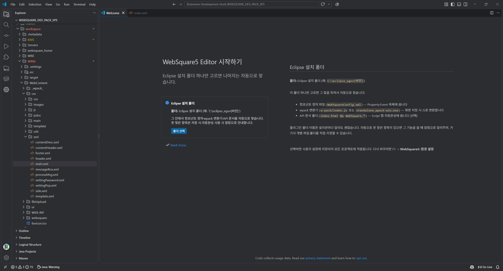
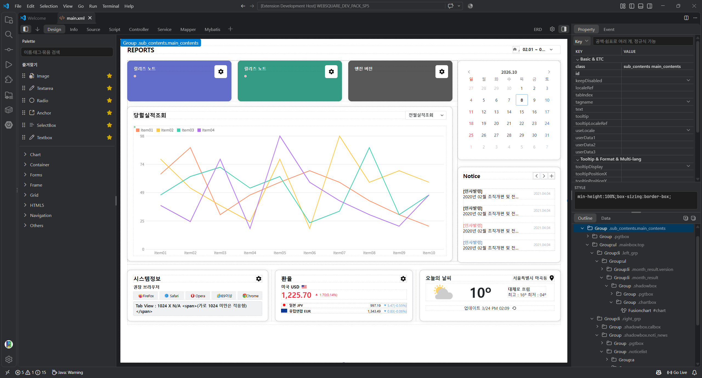

# ForWebsquare5

VS Code에서 WebSquare5 화면을 편집할 수 있는 확장 프로그램입니다.
사용 권한이 있는 WebSquare5 환경이 필요합니다.

## 사용방법

1. 확장 탭에서 **ForWebsquare5**를 설치합니다. 직접 설치하려면 [Releases](https://github.com/castle-bird/ForWebsquare5/releases)의 `.vsix`를 사용하세요.
2. 화면 XML을 열면 WebSquare5 플러그인이 설치된 **Eclipse(또는 WebSquare Studio) 폴더**를 로컬 드라이브(C:·D: 등)에서 자동으로 찾아 적용합니다. 컴포넌트 정의·wpack·API 문서는 그 폴더에서 찾고, 찾은 위치는 이 PC에 기억해 다음부터는 다시 찾지 않습니다.
   - 설치본이 여러 개면(전자정부 프레임워크 버전별 Eclipse 등) 프로젝트마다 고릅니다: 그 프로젝트를 작업 공간으로 연 Eclipse → 가장 최근에 실행한 Eclipse → 엔진 버전이 높은 것 순입니다. 알림의 **다른 설치본 선택**으로 바꿀 수 있습니다.
3. 못 찾으면 알림의 **폴더 선택**에서 Eclipse 폴더를 고릅니다. 예: `C:\WEBSQUARE_DEV_PACK_SP5\eclipse_egov4.1`. `D:\`처럼 넓게 골라도 그 밑의 설치본을 찾습니다.
   설정은 `Ctrl+Shift+P` → **WebSquare5: 환경 설정**에서 다시 바꾸거나 **설치 폴더 자동으로 찾기**를 할 수 있습니다. 안내는 `>Welcome: Open Walkthrough` → **ForWebsquare5 시작하기**에서 볼 수 있습니다.

새 화면은 탐색기에서 폴더를 우클릭하고 **New Websquare5 File...**을 선택해 만듭니다. 저장 위치를 고르면 빈 화면 XML이 열립니다. 디자이너를 사용하려면 프로젝트에 `websquare/config.xml`이 있어야 합니다.

화면 XML 파일을 열고 **Design·Info·Script·Source** 탭에서 편집합니다. 저장·Undo는 VS Code 방식 그대로 사용합니다.

WebSquare5 교육자료의 main 파일 화면입니다. 화면과 참고 자료의 출처는 WebSquare5 교육자료입니다.

자세한 기능은 [기능 설명](docs/FEATURES.md), 개발·테스트는 [테스트 실행 안내](scripts/README.md)를 참고하세요.
의견과 버그는 [Issues](https://github.com/castle-bird/ForWebsquare5/issues)로 알려 주세요.

## 고지·라이선스

WebSquare5는 Inswave Systems의 제품이며, 이 확장은 공식 제품이 아닙니다.
Inswave의 파일·Studio 소스를 포함하지 않고, 사용자의 WebSquare5 설치본과 프로젝트 리소스를 참조합니다. 자체 미리보기는 실제 엔진 화면과 다를 수 있습니다.

[MIT License](LICENSE)
