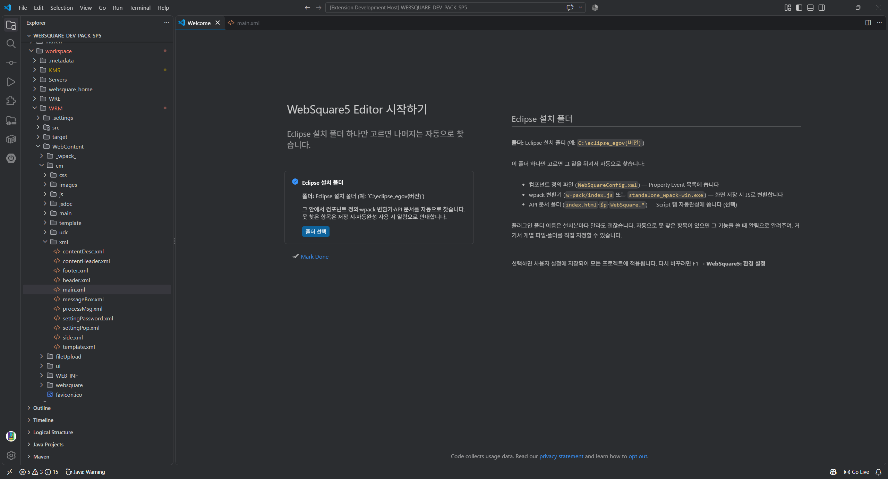
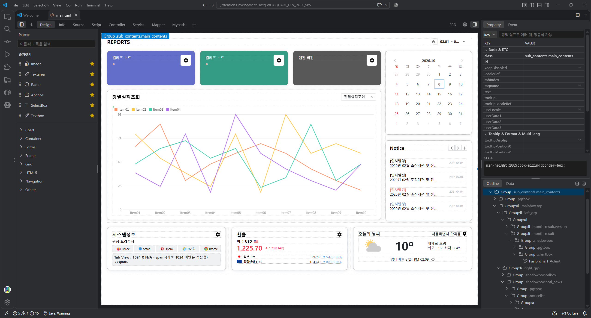

# ForWebsquare5

VS Code에서 WebSquare5 화면 XML을 디자이너로 편집할 수 있게 해 주는 확장 프로그램입니다.
Inswave Systems의 공식 제품이 아닌 비공식 확장입니다.

## 필요 환경

처음 사용하기 전에 아래 두 가지를 확인해 주세요.

- **WebSquare5 설치본**: WebSquare5 플러그인이 설치된 Eclipse 또는 WebSquare Studio가 PC에 있어야 합니다. 컴포넌트 정의·wpack 변환기·API 문서·기본 스킨을 이 설치본에서 읽습니다. 사용 권한이 있는 설치본을 사용해 주세요.
- **WebSquare5 프로젝트**: 프로젝트 안에 `websquare/config.xml`이 있어야 디자이너가 열립니다. 이 파일이 있는 폴더를 웹 루트로 보고 CSS·이미지·화면 경로를 찾습니다.

## 설치

VS Code 확장 탭(`Ctrl+Shift+X`)에서 **ForWebsquare5**를 검색해 설치합니다.

직접 설치하려면 [Releases](https://github.com/castle-bird/ForWebsquare5/releases)에서 `.vsix` 파일을 받은 뒤, 확장 탭 오른쪽 위 `...` 메뉴 → **VSIX에서 설치...**를 선택합니다.

## 시작하기

1. VS Code에서 WebSquare5 프로젝트 폴더를 엽니다.
2. 화면 XML 파일을 엽니다. 확장이 로컬 드라이브(C:·D: 등)에서 WebSquare5 설치본을 자동으로 찾아 적용합니다. 찾은 위치는 이 PC에 기억하므로 다음부터는 바로 열립니다.
3. 자동으로 찾지 못하면 알림이 뜹니다. **폴더 선택**을 눌러 Eclipse 설치 폴더를 직접 골라 주세요.
   - 예: `C:\WEBSQUARE_DEV_PACK_SP5\eclipse_egov4.1`
   - 정확한 위치를 모르면 `D:\`처럼 넓게 골라도 그 아래에서 설치본을 찾습니다.

처음 사용하는 방법은 `Ctrl+Shift+P` → `Welcome: Open Walkthrough` → **ForWebsquare5 시작하기**에서 차례대로 볼 수 있습니다.



## 화면 편집

### 새 화면 만들기

탐색기에서 폴더를 우클릭하고 **New Websquare5 File...**을 선택합니다. 저장 위치를 고르면 빈 화면 XML이 열립니다.

### 탭 구성

화면 XML을 열면 아래 탭에서 편집할 수 있습니다. 저장(`Ctrl+S`)과 실행 취소(`Ctrl+Z`)는 VS Code와 같습니다.

| 탭 | 하는 일 |
| --- | --- |
| **Design** | 프로젝트 CSS를 적용한 화면을 보며 컴포넌트를 선택·이동·크기 조절하고 속성·이벤트를 편집합니다 |
| **Info** | 프로그램 ID·이름·작성자 같은 화면 정보와 개정 이력을 편집합니다 |
| **Script** | 화면의 스크립트를 코드 편집기로 편집합니다 |
| **Source** | 화면 XML 원문을 직접 편집합니다 |



WebSquare5 교육자료의 main 파일 화면입니다. 화면과 참고 자료의 출처는 WebSquare5 교육자료입니다.

## 문제 해결

### Design 탭에 공통 CSS가 적용되지 않을 때

**CSS 주소에 WAS 컨텍스트 경로가 붙어 있는 경우**

화면에서 CSS를 `/myapp/css/stylesheet.css`처럼 컨텍스트 경로(`/myapp`)를 붙여 지정했다면, 확장은 `/myapp`을 폴더 이름으로 보고 파일을 찾지 못합니다. 이때는 설정에 컨텍스트 경로를 알려 주세요.

1. `Ctrl+,`로 설정을 열고 `for-websquare5.contextPath`를 검색합니다.
2. **settings.json에서 편집**을 눌러 아래처럼 입력합니다. Eclipse 프로젝트 속성의 Context Root와 같은 값입니다.

```json
"for-websquare5.contextPath": "/myapp"
```

컨텍스트 경로가 여러 개면 `["/myapp", "/admin"]`처럼 배열로 입력합니다. 대소문자를 구분하며, 저장하면 열린 화면에 바로 적용됩니다.

**기본 스킨이 적용되지 않는 경우**

`websquare/config.xml`에 지정한 기본 스킨 CSS가 프로젝트에 없으면, 연결된 설치본의 엔진에서 같은 파일을 자동으로 찾아 적용합니다. 따로 설정할 것은 없습니다. 설치본을 나중에 지정했다면 화면 탭을 닫았다가 다시 열어 주세요.

### 설치본을 찾지 못하거나 다른 설치본으로 바꾸고 싶을 때

`Ctrl+Shift+P` → **WebSquare5: 환경 설정**을 실행합니다.

- **설치 폴더 자동으로 찾기**: 로컬 드라이브에서 설치본을 다시 찾습니다.
- 각 항목을 골라 설치 폴더나 도구 경로를 직접 지정할 수 있습니다.

설치본이 여러 개(전자정부 프레임워크 버전별 Eclipse 등)면 프로젝트마다 알맞은 것을 골라 적용하고 알림으로 알려 줍니다. 알림의 **다른 설치본 선택**을 누르면 바꿀 수 있습니다.

## 더 알아보기

- 전체 기능은 [기능 설명](docs/FEATURES.md)에서 볼 수 있습니다.
- 의견이나 버그는 [Issues](https://github.com/castle-bird/ForWebsquare5/issues)에 남겨 주세요.

## 고지·라이선스

WebSquare5는 Inswave Systems의 제품이며, 이 확장은 공식 제품이 아닙니다.
Inswave의 파일·Studio 소스를 포함하지 않고, 사용자의 WebSquare5 설치본과 프로젝트 리소스를 참조합니다. 자체 미리보기는 실제 엔진 화면과 다를 수 있습니다.

[MIT License](LICENSE)
